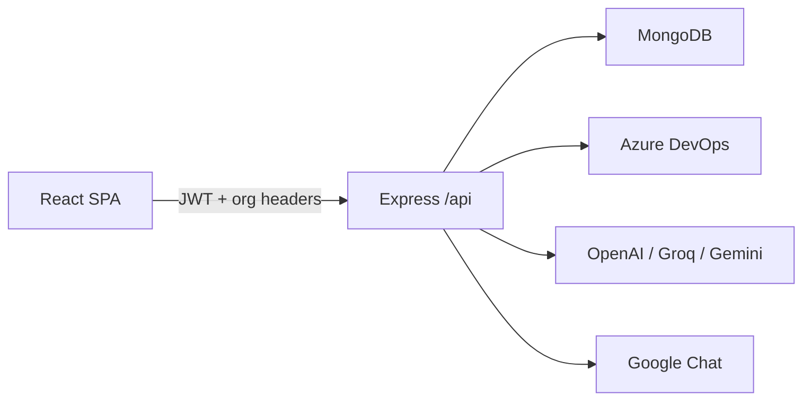
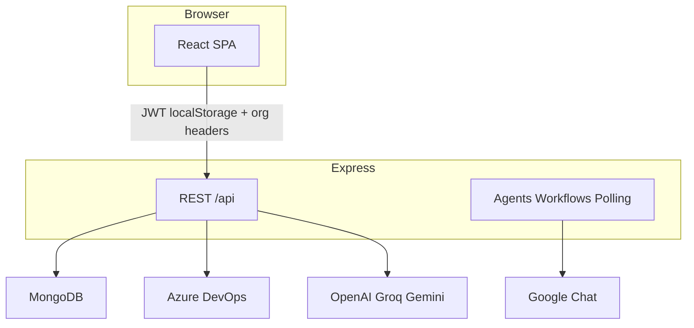

# InsightOps


**InsightOps is an AI-assisted Azure DevOps monitoring platform for engineering teams that want sprint, build, PR, and release visibility, encrypted org PATs, and multi-provider AI analysis in one dashboard.**



[Features](#features) · [Quick start](#quick-start) · [How it works](#how-it-works) · [Azure DevOps PAT scopes](#azure-devops-pat-scopes) · [Security](#security) · [Deploy](#deploy--configuration) · [Live demo](https://stginsightops.azurewebsites.net/)

## Who it's for

DevOps and engineering teams on Azure DevOps who spend too much time digging through failed pipelines, guessing at sprint blockers, and drowning in noisy alerts. InsightOps centralizes work items, builds, pull requests, and releases, then uses AI (when you configure a provider) to summarize and diagnose—without putting Azure PATs in the browser.

## Features

| Feature                           | What it does                                                                              |
| --------------------------------- | ----------------------------------------------------------------------------------------- |
| **Multi-org / multi-project ADO** | Manage several Azure DevOps orgs and switch projects; PATs stored encrypted server-side   |
| **Work items & sprints**          | Sprint tracking with AI summaries and overdue visibility                                  |
| **Pipelines & releases**          | Recent builds, failure analysis, deployment tracking, production filters                  |
| **Pull requests**                 | Active PR lists, idle detection, AI explain                                               |
| **Multi-provider AI**             | OpenAI, Groq, and Google Gemini with free-model fallback routing                          |
| **Webhooks + polling**            | Real-time ADO webhooks with configurable polling as backup                                |
| **Agents & workflows**            | In-process monitor / analyze / execute agents and build-failure, PR, and sprint workflows |
| **Notifications**                 | Google Chat alerts today; Teams/Slack backends exist but UI is not shipped yet            |
| **Activity reports**              | Dashboard reports and PDF export (Puppeteer / Chromium in Docker)                         |
| **Auth**                          | Email + password with Azure Communication Services OTP for signup and password reset      |

## Quick start

**Prerequisites:** Node.js 22+, a MongoDB instance, and (for auth emails) an Azure Communication Services connection string + verified MailFrom address.

From the repo root (after you have a local checkout):

```bash
npm run install:all
cp backend/.env.example backend/.env   # fill required vars — see linked .env.example files
npm run dev
```

- Frontend: Vite on `http://localhost:5173` (proxies `/api` → `http://localhost:3001`)
- Backend: Express on port `3001` by default

**Docker (optional):** copy [`.env.example`](.env.example) to `.env`, then `docker compose up --build`. See [`docker-compose.yml`](docker-compose.yml).

## How it works



1. Sign up / sign in; the SPA keeps the JWT and user in `localStorage` and sends `Authorization: Bearer …` plus `X-Organization-ID` / `X-Project-Name`.
2. You add an Azure DevOps organization and PAT in Settings; the server encrypts the PAT and calls ADO on your behalf.
3. Webhooks and/or polling feed agents and workflows; optional AI providers analyze builds, sprints, PRs, and releases.
4. In production, the built SPA is served from the same Express process (`backend/public`), so the browser talks same-origin `/api`.

## Azure DevOps PAT scopes

InsightOps calls Azure DevOps as **read-only**. Create a PAT with these scopes for full functionality (org-scoped is enough):

| Scope (Azure DevOps UI)     | Scope ID      | Used for                                                     |
| --------------------------- | ------------- | ------------------------------------------------------------ |
| **Work Items → Read**       | `vso.work`    | Sprints, overdue items, WIQL queries, AI work-item summaries |
| **Build → Read**            | `vso.build`   | Builds, timelines, definitions, failure analysis             |
| **Code → Read**             | `vso.code`    | Repos, PRs, commits/changes, PR threads, pipeline YAML       |
| **Release → Read**          | `vso.release` | Classic releases, environments, pending approvals            |
| **Project and Team → Read** | `vso.project` | List projects and test connection when adding an org         |

**Not required:** Write scopes, Wiki, Test Plans, Analytics, Graph/Identity, Packaging, or Service Hooks manage. InsightOps does not create/update work items, queue builds, post PR comments, or create webhook subscriptions via the PAT — configure ADO service hooks manually in Azure DevOps if you want realtime events.

**Tips:** Prefer the shortest expiry you can operate with. Use “All accessible organizations” only if one PAT must cover multiple ADO orgs.

## Security

| Concern               | Behavior                                                                                              |
| --------------------- | ----------------------------------------------------------------------------------------------------- |
| **Session**           | JWT in `localStorage` (keys `token`, `user`); not HTTP-only cookies                                   |
| **Org context**       | `currentOrganizationId` / `currentProject` in `localStorage`; sent as request headers                 |
| **Azure DevOps PATs** | Encrypted at rest in MongoDB with `ENCRYPTION_KEY`; API responses mask the PAT                        |
| **Auth emails**       | ACS Email OTPs for signup verification and password reset (`ACS_CONNECTION_STRING`, `ACS_EMAIL_FROM`) |

Required secret **names** (values never belong in git): `MONGODB_URI`, `JWT_SECRET`, `ENCRYPTION_KEY`, `ACS_CONNECTION_STRING`, `ACS_EMAIL_FROM`, `EMAIL_VERIFICATION_SECRET`, `PASSWORD_RESET_SECRET`. Full templates: [`backend/.env.example`](backend/.env.example), [`.env.example`](.env.example), [`frontend/.env.example`](frontend/.env.example).

**ACS Email setup:** Connection string from Communication Service `acs-teamtracker-prd` → **Keys**. MailFrom from Email Communication Service `acs-subdomain-email` → **AzureManagedDomain** → **MailFrom addresses**. Link the domain on `acs-teamtracker-prd` → **Email** → **Domains** before sending.

## Scripts

| Script                            | Where       | Purpose                                   |
| --------------------------------- | ----------- | ----------------------------------------- |
| `npm run install:all`             | root        | Install root, backend, and frontend deps  |
| `npm run dev`                     | root        | Concurrent backend + frontend             |
| `npm run build`                   | root        | Build frontend (`frontend/dist`)          |
| `npm start`                       | root        | Start backend only                        |
| `npm run simulate:production`     | root        | Build SPA into `backend/public` and start |
| `npm run format` / `format:check` | root        | Prettier                                  |
| `npm test`                        | `backend/`  | Jest                                      |
| `npm run lint`                    | `frontend/` | ESLint                                    |

## Deploy / Configuration

**Local production-like:** `npm run simulate:production` or build frontend and copy `frontend/dist/*` → `backend/public/`, then `cd backend && npm start`.

**Docker:** multi-stage [`Dockerfile`](Dockerfile) (Node 22, installs Chromium for PDF). Compose wires env and health-checks `GET /api/health`.

**CI / hosting:**

- GitHub Actions: [`.github/workflows/deploy.yml`](.github/workflows/deploy.yml) (production) and [`deploy-stage.yml`](.github/workflows/deploy-stage.yml) (staging) build the frontend into `backend/public` and deploy to **Azure App Service**
- Azure DevOps: [`pipelines/`](pipelines/) includes zip-style App Service pipelines and container build/push to ACR

**Frontend build args (optional):** `VITE_DEMO_VIDEO_URL` — see [`frontend/.env.example`](frontend/.env.example).

## Tech stack

- **Backend:** Node.js 22 (ESM), Express 4, Mongoose 8, JWT / bcrypt, Winston, Helmet, node-cron, Puppeteer
- **AI:** OpenAI SDK, Groq SDK, Google Generative AI
- **Frontend:** React 18, React Router 6, Vite 4, Tailwind 3, Radix / shadcn-style UI, Recharts, Motion
- **Data / email:** MongoDB, Azure Communication Services Email
- **Ops:** Docker, GitHub Actions → Azure App Service, Azure Pipelines (zip + container)

## Project structure

```
InsightOps/
├── frontend/                 # React + Vite SPA
│   └── src/pages|components|contexts|api/
├── backend/                  # Express API + agents
│   ├── agents/               # Monitor / Analyze / Execute / rules
│   ├── ai/                   # Multi-provider + free-model router
│   ├── api/                  # Authenticated REST mounts
│   ├── routes/               # Auth routes
│   ├── webhooks/             # ADO webhook receivers
│   ├── polling/              # Backup pollers
│   ├── workflows/            # Workflow engine + definitions
│   └── main.js               # Entrypoint + SPA static serve
├── pipelines/                # Azure DevOps CI definitions
├── Dockerfile
├── docker-compose.yml
└── package.json              # install:all / dev / build orchestration
```

## API overview

Authenticated routes expect a Bearer JWT and org/project headers where applicable.

| Mount                    | Role                                                                            |
| ------------------------ | ------------------------------------------------------------------------------- |
| `GET /api/health`        | Public health                                                                   |
| `/api/auth/*`            | Signup OTP, login, password-reset OTP                                           |
| `/api/organizations`     | Orgs, default org, test connection, projects                                    |
| `/api/*`                 | Settings, work items, builds, PRs, releases, AI, logs, dashboard, notifications |
| `/api/webhooks`          | Org-scoped ADO webhook receivers                                                |
| `/api/diagnostics`       | Health detail, metrics, polling status                                          |
| `/api/queue`             | Queue / dead-letter status                                                      |
| `/api/agent-dashboard/*` | Agent overview, rules, workflows, learning                                      |

Examples of verified core paths: `GET /api/builds/recent`, `POST /api/builds/:buildId/analyze`, `GET /api/pull-requests/idle`, `GET /api/work-items/ai-summary`, `GET /api/agent-dashboard/overview`.

## FAQ

**Is there a separate backend in production?**  
No. Express serves the built SPA and `/api` from one process.

**Why a Vite proxy in development?**  
ADO and browser CORS are avoided by proxying `/api` to `localhost:3001`. Production uses same-origin.

**Where is my token stored?**  
In `localStorage`. Clearing site data or refreshing after wipe ends the session. Prefer a trusted device and strong JWT secret.

**Are Slack and Teams supported?**  
Notification backends include Teams/Slack paths, but the Settings UI only enables Google Chat today (Teams/Slack marked coming soon).

**Do I need an AI key to use the app?**  
You can monitor ADO without AI. AI summaries and analysis need a configured provider under Settings.

## Contributing

Issues and PRs are welcome. There is no `CONTRIBUTING.md` yet. Screenshots or a short demo GIF under something like `docs/assets/` would help the README’s “visual proof” slot.

When you change routes, auth storage, notification channels, or deploy targets, update this README in the same PR (or add that check to your release checklist) so docs stay aligned with code.

## License

License TBD — no `LICENSE` file is present in the repository yet.
